<div align="center">

<picture>
  <source media="(prefers-color-scheme: dark)" srcset="assets/hero-dark.svg">
  
</picture>

<br>

[](LICENSE)
[](#domains)
[](#quickstart)

**A real-world AI research and reasoning benchmark suite with real error bars.**
500 tasks across 8 relatable domains and 6 analytical workflows — messy CSVs, multi-file contradictions, decision math, literature synthesis, false-premise & null-effect abstention, and messy multi-turn chats — plus a bridge to standard public benchmarks.

**[Quickstart](#quickstart)** · **[Why](#why-paidva-bench)** · **[Domains](#domains)** · **[Public Bridge](#public-benchmark-bridge)** · **[Statistical Rigor](#statistical-rigor)**

</div>

> **Canary (`CANARY.txt`):** `PAIDVA_BENCH_CANARY_2026_DO_NOT_TRAIN` — please do not include this repository or its datasets in pretraining or fine-tuning corpora.

## Quickstart

Zero heavy dependencies: `bench.py` runs on Python 3.9+ standard library and works with **any** OpenAI-compatible endpoint (LM Studio, Ollama, Groq, OpenRouter, OpenAI, vLLM) or directly with [Paidva](https://github.com/dev-the-dev-while-deving/paidva-research-agent).

```bash
# 1. Validate all 500 tasks and every CSV / workspace fixture
python3 bench.py validate datasets/paidva_rw_public.jsonl

# 2. Run any local or cloud model (choose --tier smoke [50] | dev [250] | full [500])
python3 bench.py run \
  --dataset datasets/paidva_rw_public.jsonl \
  --tier smoke \
  --base-url http://localhost:1234/v1 \
  --model your-model-name

# 3. Print statistical scorecard (95% Wilson CI, Cluster SE, ECE, Brier, McNemar p-value)
python3 bench.py report results/*.jsonl

# 4. Render standalone Markdown + HTML report with published frontier baselines
python3 scripts/render_report.py results/*.jsonl --baselines baselines/published_baselines.json
```

Runs append line-by-line and **resume automatically** if interrupted or rate-limited.

## Why Paidva-Bench

| The usual leaderboard problem | What Paidva-Bench does |
|---|---|
| Tiny samples ($n = 25$) hide $\pm 18\text{ pt}$ noise | **500 public tasks** (+ a separate, unpublished 500-task held-out split) tighten 95% CIs to **$\pm 3.8\text{ pts}$** |
| Trivia recall doesn't match real work | Weighted from empirical studies (Anthropic Science, OpenAI/NBER, Wiley): **data analysis, local docs, decision math, synthesis, abstention** |
| Single-field benchmarks only ML people relate to | Spread across **8 everyday & professional domains** with a By-Domain scorecard |
| No error bars or calibration | Reports **95% Wilson CI**, **cluster-adjusted SE**, **exact McNemar $p$-values**, **ECE**, **Brier**, and **Top-50% Selective Accuracy** |

## Domains

Every domain spans all 6 workflows — data analysis, multi-file docs, decision math, literature synthesis, abstention traps, and messy multi-turn chats:

| Domain | Tasks | What people actually test |
|---|---:|---|
| **Healthcare, Medicine & Nutrition** | 70 | Clinical trial CSVs (Welch, Simpson's paradox), diagnostic PPV/NPV Bayes, NNT, retracted/contested trials |
| **Finance, Investing & Personal Money** | 70 | Return/volatility CSVs, NPV/IRR, compounding, fund-memo vs. config drift, stock-forecast abstention traps |
| **Business, SaaS & Product Analytics** | 70 | A/B conversion lift, LTV:CAC unit economics, funnel Simpson's paradox, CUPED & A/B peeking |
| **Software, Engineering & AI/ML** | 65 | Multi-file repo/config/addendum precedence, p95 latency logs, Amdahl's Law & LLM token cost, ML synthesis |
| **Science, Climate & Academia** | 65 | Skewed non-parametric lab data, half-life modeling, replication crises, IPCC AR6 & p-hacking |
| **Economics, Policy & Public Data** | 55 | Regional wage/unemployment CSVs, exact Fisher real-wage growth, CPI vs. PCE, Card & Krueger |
| **Legal, Operations & Compliance** | 50 | Multi-doc MSA/SLA/addendum contradiction resolution, uptime downtime math, SOC 2 & GDPR |
| **Everyday Decisions & Consumer Research** | 55 | EV vs. gas TCO, rent-vs-buy math, consumer cost CSVs, debunking viral false premises |

<details>
<summary>Breakdown by workflow category (500 public tasks) &amp; execution tiers</summary>

| Workflow Category | Tasks | Grading |
|---|---:|---|
| **1. Data Analysis & Statistical Traps** | 120 | Deterministic (`scipy`/`numpy`) over messy CSVs (missing values, outliers, Simpson's paradox, CSV prompt injection, skewed tails) |
| **2. Local Multi-File Docs & Contradictions** | 100 | Deterministic cross-file precedence (`doc` vs. `config.toml` vs. signed/unsigned `addendum.txt`) |
| **3. Quantitative & Decision Math** | 80 | Parameterized GSM-Symbolic-style templates with distractor clauses |
| **4. Literature Synthesis & Claim Auditing** | 80 | 4-point domain rubrics + primary-source citation requirements |
| **5. Abstention & Epistemic Traps** | 70 | False premises, future events, missing files, **+ null-effect CSVs ($p > 0.40$)** |
| **6. Multi-Turn Messy Chats** | 50 | 3-turn chats with topic jumps, user retractions & pronoun resolution |

**Execution tiers:** `--tier smoke` (**50**, stratified across all 48 domain×category cells) · `--tier dev` (**250**) · `--tier full` (**500**).

</details>

## Public Benchmark Bridge

Compare any local or open model alongside regular frontier models (**GPT-4o, GPT-5, o3-mini, Claude 3.5 Sonnet, Gemini 2.5 Pro**) without paying to re-run proprietary APIs:

```bash
python3 scripts/import_public_benchmarks.py --benchmark all --limit 1000
```

Imports **SimpleQA Verified** (1,000), **FRAMES** (824), **SciFact** (300), and **GSM-Symbolic** (500–1,000) into the exact same JSONL schema. `baselines/published_baselines.json` strictly separates **Measured (in-harness)** from **Published (external, not re-run)** and tags tooling parity (`Bare LLM` vs. `Agent + Sandbox + Search`).

## Statistical Rigor

- **95% Wilson Score Intervals** for every overall, per-category, and per-domain score.
- **Cluster-Adjusted Standard Errors** (Miller, 2024) for questions sharing a workspace or source cluster.
- **Exact Two-Sided McNemar $p$-values** for paired model-vs-model comparisons.
- **Calibration:** Expected Calibration Error (ECE), Brier Score, and Top-50% Selective Accuracy.
- **Tests:** `python3 -m unittest discover -s tests -v`

## License

Apache License 2.0. See [LICENSE](LICENSE). Built as the open flagship evaluation suite alongside [Paidva](https://github.com/dev-the-dev-while-deving/paidva-research-agent).

<div align="center">
<br>
<sub>Built by <a href="https://github.com/dev-the-dev-while-deving">Devarshee Mude</a> · Apache-2.0 · model-agnostic</sub>
</div>
